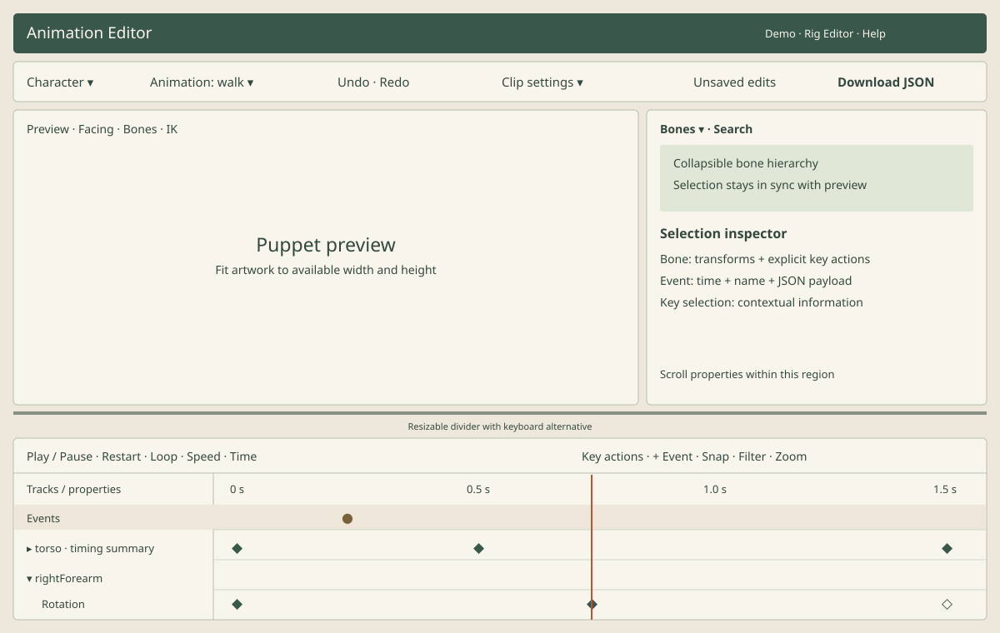

# Animation editor layout research

Research date: 9 October 2026. Repository revision: `5a19b84`, version `0.5.2-8.3`.

The review below describes that baseline revision; its screenshots and source line references predate implementation. The implemented candidate and its measurements are recorded at the end of this report.

## Finding

**The reviewed layout has useful components, but it is a weak default for repeated animation authoring.** Its largest problem is the separation of the preview, timeline, and session controls across a long page. A compact workspace with a persistent command bar, a preview beside a selection inspector, and a full-width timeline is the strongest next design to test.

There is no evidence that any arrangement is universally “the best possible.” This review establishes specific problems through browser measurements and recommends a candidate using comparable tools and usability guidance. It does not establish animator preferences or measured productivity improvements.

## Method and evidence

Reviewed the current markup, CSS, timeline rendering, bone inspector, selection state, interpolation presentation, and development guide. Inspected the running editor in local headless Chrome through Playwright at eight CSS viewport sizes. Baseline measurements used the demo puppet, `idle`, time zero, a selected root bone, and the default collapsed timeline. Bone selection was triggered programmatically to avoid scrolling during geometry capture.

Also exercised selecting `walk`, entering and committing a right forearm rotation, clicking Undo, and adding an event. The clip selector used Playwright's programmatic `selectOption`; its recorded zero scrolling is not evidence that a person can reach the selector without scrolling. Pointer clicks on Undo and Add Event did scroll into view. No browser page exceptions were recorded. This was a layout audit, not a complete regression or accessibility test.

Evidence:

- [Desktop viewport screenshot](research/animation-editor-layout/current-1440x900.png)
- [Entire desktop page](research/animation-editor-layout/current-1440-full.png)
- [1000-pixel-wide viewport](research/animation-editor-layout/current-1000x768.png)
- [Selected event screenshot](research/animation-editor-layout/event-selected.png)
- [Raw measurements](research/animation-editor-layout/measurements.json)
- [Recommended layout diagram](research/animation-editor-layout/recommended-layout.svg)

All positions below are document coordinates measured from the page's top; widths are CSS pixels. Rounded values can differ by one pixel from calculations using unrounded rectangles.

| Viewport    | Timeline panel starts | Ruler starts | Timing lane width | Animation selector starts | Page height |
| ----------- | --------------------: | -----------: | ----------------: | ------------------------: | ----------: |
| 1280 × 800  |                   918 |         1107 |               397 |                      1572 |        2373 |
| 1440 × 900  |                  1053 |         1242 |               490 |                      1706 |        2487 |
| 1920 × 1080 |                  1103 |         1292 |               524 |                      1757 |        2537 |
| 1600 × 1400 |                  1103 |         1292 |               524 |                      1757 |        2537 |
| 1024 × 768  |                   703 |          992 |               248 |                      1456 |        2299 |
| 1000 × 768  |                  1812 |         2001 |               512 |                      2465 |        3308 |
| 768 × 1024  |                  1617 |         1850 |               377 |                      2314 |        3275 |
| 390 × 844   |                  1704 |         2065 |               172 |                      2529 |        3967 |

## What works

The editor already has recognizable animation concepts: bone hierarchy, local transform inspector, property tracks, a ruler, transport controls, and distinct event markers. Bone selection connects the preview and inspector. Temporary fields have a visible highlight and explicit commit controls. Keyboard scrubbing, key nudging, selection, history, and clipboard operations provide useful alternatives to pointer work.

The timeline's labels and lanes scroll together, its ruler stays visible within that scroll area, and its row rendering preserves surviving controls. The current Timeline controls disclosure is a useful precedent for moving longer explanations out of the primary workspace. Preserve these behaviors and the warm visual identity.

## Main problems, ordered by impact

### 1. Core authoring areas do not fit together on normal desktop screens

At 1440 × 900, the preview begins at y=226 and ends at y=1035. The timeline starts at y=1053, so even Play is outside the initial screen. At 1920 × 1080, the timeline is still below the initial screen. The larger monitor receives almost no additional timing width because the shell caps its width at 1500 pixels.

The header is 202 pixels tall on these desktops. The preview height follows its width through a fixed `760 / 640` aspect ratio, instead of sharing the available screen height with the timeline. The authoring sidebar spans both grid rows and leaves a large blank area beside the timeline. These rules make a scrolling document rather than a workspace for inspecting pose and timing together.

Evidence: [editor layout CSS](../src/devtools/animation-editor/style.css#L20), [stage proportions](../src/devtools/animation-editor/style.css#L84), [sidebar placement](../src/devtools/animation-editor/style.css#L468), [shared shell](../src/ui/viewShell.css#L1).

### 2. Essential session controls are below the editing work

At 1440 × 900, Animation selection starts at y=1706, Undo at y=1944, Download at y=1971, and the dedicated dirty indicator at y=2244. Clicking Undo after a bone edit caused Playwright to scroll to y=1508, putting the entire preview above the visible screen. Keyboard Undo helps experienced users, but button discovery and visible confirmation still matter.

The session section also combines frequently needed commands with import troubleshooting, export explanations, optional metadata, and developer logging. The recommended primary command bar should show character, animation, Undo/Redo, Download, and save/validation state. Specialized operations can remain available through clearly labelled secondary panels. This follows NN/G's recommendation to keep frequent actions immediately available and disclose specialized options on demand. [Progressive Disclosure](https://www.nngroup.com/articles/progressive-disclosure/).

### 3. The timeline gives too little space to time

The timeline occupies only the preview's column. Its labels then take 42% of the inset. At 1440 pixels wide, the time axis is only 490 pixels; at 1024 pixels, it is 248 pixels. Existing rendering fits the entire duration into that width; there is no timeline zoom/pan range or track filter in the reviewed controls. That will constrain dense or long clips, although this audit did not test large production animations.

Use the full workspace width for the timeline, with a resizable label column starting around 220–260 pixels. For illustration, the measured 1384-pixel workspace minus a 240-pixel label column and about 60 pixels of padding gives roughly 1084 pixels for time, about 2.2 times the current width. This is a design estimate, not a measured prototype result.

Rive documents timeline zoom/pan and selected-object filtering. Spine provides property filters and selection-dependent or locked track views. These are useful reference patterns for a later density improvement. [Rive Timeline](https://rive.app/docs/editor/animate-mode/timeline), [Spine Dopesheet](https://esotericsoftware.com/spine-dopesheet).

### 4. Selecting an event moves the tracks

In the `walk` workflow at 1440 × 900, adding an event opened a 286-pixel inspector above the ruler. Including surrounding spacing, the ruler moved from y=1242 to y=1536: **294 pixels of layout movement**. The bone inspector remained in the other column with disabled fields while the event was selected.

Place bone and event properties in one stable selection-inspector region. When an event is selected, show its time, name, and JSON payload there; preserve timeline position and size. Rive's right sidebar changes its controls according to the selection, providing a relevant precedent. [Rive Inspector](https://rive.app/docs/editor/interface-overview/inspector).

### 5. The default timeline hides timing information

The initial demo timeline showed 17 rows, including Events, but zero keyframe markers: all bone property groups start collapsed. Collapsed bones show whether keys exist through a dot, but do not show their times. Expanding a bone reveals all five transform properties, including empty ones. This makes the first view poor for reading the animation and increases vertical work after expansion.

Add read-only summary markers to collapsed bone rows, or initially reveal the keyed properties of a relevant bone. Prefer summary markers first, because they preserve the compact overview without automatically changing a user's expanded rows. A Selected/Keyed/All filter can follow, with an obvious active state and reset. Keep empty properties reachable for authoring. Spine's collapsed bone rows retain aggregate key timing, while Blender's Dope Sheet organizes property channels along a time axis. [Spine Dopesheet](https://esotericsoftware.com/spine-dopesheet), [Blender Dope Sheet introduction](https://docs.blender.org/manual/en/4.5/editors/dope_sheet/introduction.html).

### 6. The responsive breakpoint makes access substantially worse

Reducing width from 1024 to 1000 pixels moves the timeline from y=703 to y=1812. The one-column layout puts the entire bone hierarchy and inspector between the preview and timeline, while the now wider preview grows taller. At 390 pixels, the page is almost 4000 pixels tall.

At constrained widths, retain preview and timeline as the primary arrangement and open the inspector as a drawer or explicit panel. A smaller screen should change how secondary controls are accessed, rather than insert the whole inspector ahead of timing controls. Allow document scrolling at large text zoom and very small heights; a rigid viewport layout must not clip essential controls.

### 7. Read-only and specialized controls consume primary space

Selected key interpolation appears as an always-disabled dropdown, although the format supports only clip-level Linear interpolation. Its help and legend occupy timeline height. The clip's Default (Linear) and explicit Linear choices produce identical motion, making this primarily a metadata distinction. Use a small read-only selection value and move the explicit declaration to clip settings. A curve editor or per-key easing control would require separate format/runtime work.

Markers use 20 × 24-pixel targets. Improve targeting when reorganizing the timeline, while retaining spacing, keyboard operation, and an equivalent selection path. WCAG's guidance uses 24 × 24 pixels with exceptions for spacing, equivalent controls, and essential spatial layouts; target dimensions alone do not establish a conformance failure. [W3C Target Size (Minimum)](https://www.w3.org/WAI/WCAG22/Understanding/target-size-minimum).

## Recommended candidate

Use a compact header and persistent command bar. Below them, share the available height between an upper preview/inspector area and a full-width lower timeline. Fit the preview canvas to both dimensions of its host while preserving the puppet's proportions. Add a draggable divider between preview and timeline and an accessible keyboard alternative; retain a reset-layout command. Spine's resizable, tabbed views support the broader principle of allowing workspace adjustment. [Spine Views](https://esotericsoftware.com/spine-views).

Keep the bone list collapsible above the selection inspector in the initial desktop design. A permanently separate left hierarchy would consume another column on laptops. Consider that arrangement as an optional wide-screen layout if larger rigs show a need. The existing inspector's property rows require roughly 339 pixels before sidebar padding, so narrowing it requires intentional control reflow.

Use clear labels such as Download JSON and Clip settings. State beside Download that it saves an exported file, and distinguish temporary values from committed unsaved edits. Preserve existing history, draft recovery, import confirmation, and export-checkpoint semantics. Put Copy JSON, import/paste, discard/revert, round-trip reload, and logging in appropriate secondary sections, retaining the current confirmations.

| Candidate                                                            | Main advantage                                               | Tradeoff                                                   | Assessment                          |
| -------------------------------------------------------------------- | ------------------------------------------------------------ | ---------------------------------------------------------- | ----------------------------------- |
| Upper preview + right inspector; full-width bottom timeline          | Keeps the core workflow together and gives timing more width | Bone list and properties share a sidebar                   | Best candidate to prototype first   |
| Separate left hierarchy + preview + right inspector; bottom timeline | Strong separation for large rigs                             | Less preview space and more panel management on laptops    | Optional wide-screen candidate      |
| Large preview with floating editing panels                           | Maximizes pose inspection                                    | Can obscure artwork or tracks and requires panel placement | Useful preview mode, weaker default |
| Current long page with reordered controls                            | Smallest implementation change                               | Scrolling still separates pose and timing                  | Interim improvement only            |

These assessments are design judgments, not results of a comparative user study.

## Delivery order and validation

1. Move the clip selector, history, Download, and status into a compact persistent command area; disclose long help and specialized operations.
2. Bound the preview by available height, make the timeline full width, and give its label column a practical width. Adapt the canvas sizing with the layout.
3. Move event fields into the selection inspector and revise the narrow-screen arrangement.
4. Add collapsed timing summaries, track filtering, and timeline zoom/pan as separate interaction work.

For the first prototype, target simultaneous visibility of the full preview, active inspector, transport, ruler, and useful tracks at 1280 × 800 and 1440 × 900 without document scrolling. Selecting events should not displace the ruler. Screen-height and text-zoom constraints should retain reachable controls through intentional overflow or drawers. Verify focus order against visual order when moving controls; the current DOM places session controls before authoring despite rendering them below it.

Then compare the current editor with the candidate using animators of mixed experience. Ask them to switch clips, key a forearm rotation at a specified time, retime a multi-bone selection, edit an event payload, undo, and export. Measure completion, errors, scroll travel, time, and whether they can explain temporary versus committed versus exported state. Include a long clip and a larger rig, plus keyboard use and text zoom. A small formative study can expose problems; it cannot prove a universal optimum or a statistically reliable speedup.

Confidence is high in the measured visibility, width, and event-displacement problems. Confidence is moderate that the proposed arrangement improves the main workflow. Exact panel sizes, default expansion/filtering, and a separate hierarchy need prototype and user validation. Browser checks remain local-only, consistent with repository preferences.

## Implemented candidate — 10 October 2026

The recommended arrangement is implemented. The command bar keeps animation selection, history, download, and session status above a resizable preview/inspector area and a full-width timeline. Event fields replace bone fields in the inspector. Clip settings, file tools, and help use secondary disclosures or dialogs. Narrow screens use an inspector drawer over the preview, leaving the timeline accessible. Collapsed timing summaries, All/Keyed/Selected filters, Fit/2×/4×/8× zoom, sticky labels, and a resizable label column are included. [Workspace guide](animation-editor.md#workspace).

At 1440 × 900, the page height falls from 2487 to 900 pixels, the header from 202 to 49 pixels, and the ruler moves from y=1242 to y=660. Timing width grows from 490 to 1142 pixels (2.33×). Animation selection and Undo now start at y=68. Event selection preserves the ruler's position.

| Viewport    | Ruler starts | Timing lane width | Page height |
| ----------- | -----------: | ----------------: | ----------: |
| 1280 × 800  |          602 |               982 |         800 |
| 1440 × 900  |          660 |              1142 |         900 |
| 1920 × 1080 |          764 |              1622 |        1080 |
| 1000 × 768  |          599 |               702 |         768 |
| 768 × 1024  |          797 |               470 |        1024 |
| 390 × 844   |          688 |               202 |         850 |

Measurements use `demo-puppet`, `idle`, time zero, selected root, All tracks, and Fit zoom. Root selection was triggered programmatically for geometry capture; the drawer was then closed on narrow screens. No page exceptions were recorded. Phone layouts have an 850-pixel minimum height and allow document scrolling on shorter screens. Tracks and inspector content scroll within their panels.

- [Implemented desktop screenshot](research/animation-editor-layout/implemented-1440x900.png)
- [Implemented phone screenshot](research/animation-editor-layout/implemented-390x844.png)
- [Implemented measurements](research/animation-editor-layout/implemented-measurements.json)

Validation passed: 1410 unit tests; formatting, lint, and type checking; and the production demo build. Local Playwright checks passed for 32 development/production workspace and import/export executions, seven additional development authoring/playback/clipboard scenarios, and four development/production preview-authoring and event-deletion executions. The event-inspector unit check was rerun after the deletion fix. Browser checks cover panel resizing, reset, horizontal zoom and key dragging, endpoint targeting, filters, event selection, dialog focus, narrow-screen drawers, rendered-pose round trips, field drafts, history, and unchanged-control playback rendering.

This establishes the candidate's measured layout and exercised interaction behavior. Comparative animator usability testing remains the next step for evaluating productivity and preferred panel defaults.
