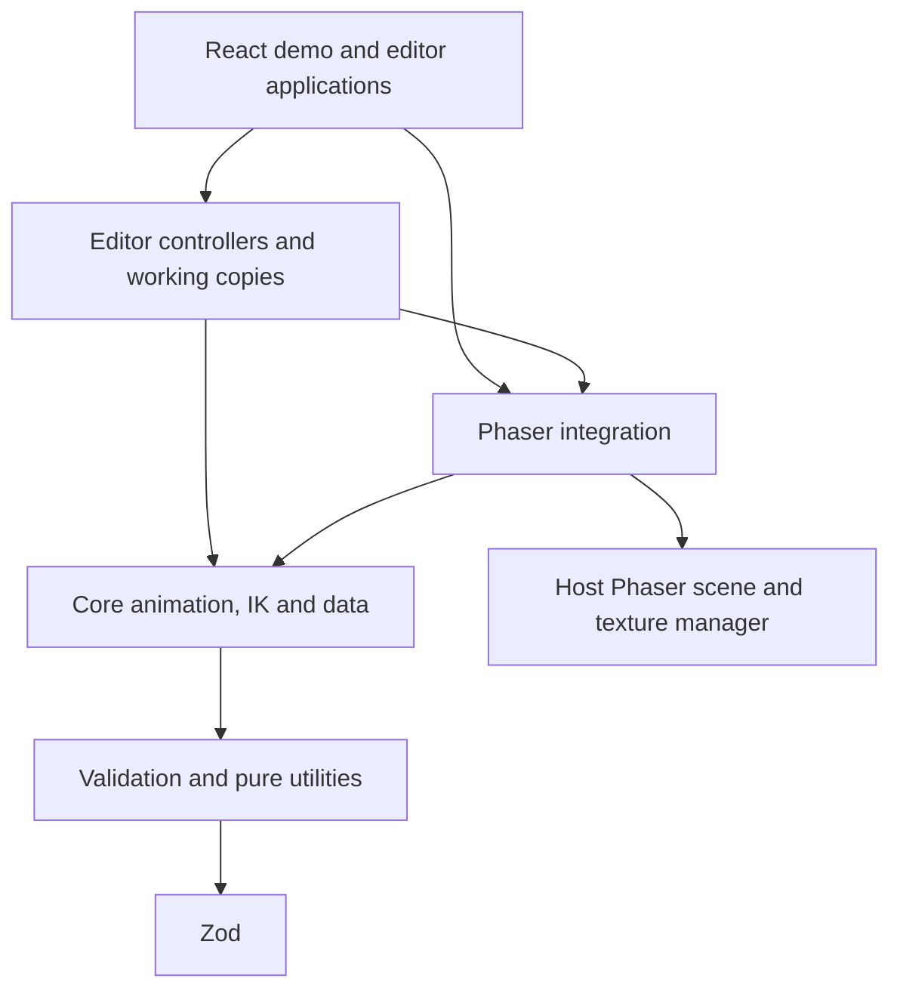

# Runtime architecture and public API — v0.6.1

[All guides](../README.md#guides)

The library is reusable without the authoring applications. Phaser owns rendering and scene integration; React owns application views. The package version is `0.6.1`. Nothing has been published to npm.

## Architecture audit: before and after

The v0.5.8.6 engine already had no imports from React, `devtools`, `ui`, or application `shared` modules. Its root entry combined Phaser APIs with the renderer-independent `/core` entry. Pure authoring utilities also lived in the engine, and the reusable scene character loader lived under application `shared`. The editors independently owned working copies, selections, histories, import dialogs, IK handles, onion skins and navigation.

v0.6.1 retains those implementations and adds explicit public barrels. Only the scene loader implementation moves: `shared/loadSceneCharacter.ts` now re-exports `engine/loadSceneCharacter.ts`. Existing applications and tests keep their imports. The root re-exports `/runtime`; `/core` retains every previous export. No new dependency or editor package is introduced.

| Layer                               | Actual modules                                                                                                                                                                                       | Dependency direction                                                                                                    |
| ----------------------------------- | ---------------------------------------------------------------------------------------------------------------------------------------------------------------------------------------------------- | ----------------------------------------------------------------------------------------------------------------------- |
| Shared contracts and pure utilities | `engine/types.ts`, `readonlyData.ts`, affine/bone/animation math, JSON utilities                                                                                                                     | Framework independent; used by runtime and editors                                                                      |
| Validation and serialization        | `schemas.ts`, `validation.ts`, `externalData.ts`, `Pose.ts`, `CharacterDefinition.ts`                                                                                                                | Zod and engine data/rig/clip utilities; no application state or browser I/O                                             |
| Animation and IK                    | `Joint`, `AnimationClip`, `AnimationPlayer`, `AnimationLayerEvaluator`, `AnimationPose`, `ik/` solver, constraint and bake modules                                                                   | Engine data, validation and math; Phaser-free except `ik/IKDebug.ts`                                                    |
| Phaser integration                  | `Bone`, `Puppet`, `PuppetRenderer`, `PuppetAttachments`, `PuppetPoseController`, runtime debug views                                                                                                 | Phaser and core; never React or editor controllers                                                                      |
| Asset loading                       | `CharacterLoader`, `queueCharacterTextures`, `loadSceneCharacter`                                                                                                                                    | Metadata loader uses fetch/custom I/O; image helpers use Phaser and core                                                |
| Editor documents and controllers    | `devtools/rig-editor/RigEditorState`, `animation-editor/AnimationEditorState`, document/selection/playback/command controllers; `devtools/shared/SnapshotHistory`, draft/artwork/package controllers | Consume engine APIs and editor utilities; runtime has no reverse dependency                                             |
| React applications                  | `ui/`, `demo/`, `devtools/**.tsx`, editor `main.tsx` and scenes                                                                                                                                      | Views mount controllers and Phaser games; navigation and browser dialogs stay here                                      |
| Asset packaging                     | `devtools/shared/package/characterPackage`, ZIP workers, `PackageController` and panels                                                                                                              | Editor snapshots and binaries use engine validation/loading for round trips; packaging is absent from the runtime graph |



The test suite parses imports and exports, including type and dynamic imports. Every engine source dependency must resolve to another engine module or the declared Phaser/Zod dependencies. `/core`, `/serialization` and `/data` have no transitive Phaser value import. Runtime value dependencies have no cycles. Type-only dependencies do not initialize modules.

## Entry points

| Import                                 | Contract                                                                                                                             |
| -------------------------------------- | ------------------------------------------------------------------------------------------------------------------------------------ |
| `paper-puppeteer-engine`               | Backward-compatible browser entry; same values as `/runtime`                                                                         |
| `paper-puppeteer-engine/runtime`       | Explicit Phaser runtime: `Puppet`, `Bone`, scene/texture loaders, and existing core APIs                                             |
| `paper-puppeteer-engine/core`          | Renderer-independent loading, rigs, joints, animation playback/evaluation, slots, IK and existing pure authoring APIs; works in Node |
| `paper-puppeteer-engine/data`          | Type-only authored rig, animation, pose, character, JSON and IK contracts; emitted JS exports no values                              |
| `paper-puppeteer-engine/serialization` | Existing version constants, schemas, errors, JSON parsing/validation, character assembly and `serializePose`; works in Node          |

The Editor entry points remain the Vite application modules `src/devtools/rig-editor/main.tsx` and `src/devtools/animation-editor/main.tsx`, mounted by their existing HTML routes. They are application entry points, not supported npm subpaths. Internal state/controller imports are for repository authoring code. This distinction keeps React out of consumer dependencies.

## Supported runtime operations

| Use                                   | Existing API                                                                                                                                     |
| ------------------------------------- | ------------------------------------------------------------------------------------------------------------------------------------------------ |
| Load immutable character metadata     | `CharacterLoader.load(url, fetcher?, options?)`, `CharacterDefinition.fromData(data, baseUrl?)`                                                  |
| Load scene artwork                    | `loadSceneCharacter(scene, url, options?)`; optionally pass `options.definition` to reuse loaded metadata                                        |
| Queue artwork in a host preload phase | `queueCharacterTextures(scene, definition, options?)`                                                                                            |
| Create and position a puppet          | `new Puppet(scene, { definition, x?, y?, scale?, facing?, skin?, autoUpdate? })`; rig-based construction remains supported                       |
| Play, switch and crossfade            | `puppet.play(name, { fadeDuration?, restart?, speed?, layer? })`                                                                                 |
| Control playback                      | `stop`, `pause`, `resume`, `restart`, `setSpeed`, `setPlaybackMode`, `setAnimationFPS`, `sampleAnimation`                                        |
| Layers                                | `setLayerMask`, `setLayerWeight`, `clearLayer`; base layer behavior is unchanged                                                                 |
| Skins and artwork selection           | `setSkin` replaces assignments; `applySkin` applies a sparse override; `setAttachment`, `clearAttachment`                                        |
| Attached Phaser props                 | `attach`, `attachToSlot`, `detach`                                                                                                               |
| Event subscriptions                   | `onAnimationEvent`, `onAnimationComplete`; each returns an unsubscribe function                                                                  |
| Animation queues                      | `queue(name, options?)`, `getQueue()`, `clearQueue()`, `stopQueue()`, `replaceQueue(requests)` on Puppet and AnimationPlayer                     |
| Playback lifecycle                    | `getPlaybackStatus(layer?)`, `onPlaybackLifecycle(listener)` on Puppet and AnimationPlayer; snapshots include playback-instance identity         |
| IK controls                           | `getIK`, `addIK`, `setIKTarget`; constraint target/provider, mix, enabled, end offset, bend and priority controls; `syncIK` / `syncPose`         |
| Cleanup                               | `puppet.destroy()`, `puppet.isDestroyed`; standalone `AnimationPlayer.dispose()`, `TwoBoneIKConstraint.dispose()` and their `isDisposed` getters |

Times, deltas and fades are milliseconds. Positions are pixels, rotations radians, and scales unitless. IDs remain strings for compatibility; existing validation checks names and cross-file references rather than requiring new branded IDs. Unknown clips, bones, slots, skins and constraints retain their existing errors.

Runtime `PlaybackInstanceId` is a player-local increasing number, separate from authored string animation IDs. Lifecycle types are exported from `/core`, `/runtime` and the package root. They are runtime-only and do not appear in authored JSON or the type-only `/data` entry. See [playback lifecycle](playback-lifecycle.md) for the v0.7.1 contract and [animation queues](animation-queues.md) for the v0.7.2 completion-driven FIFO. `AnimationQueueRequest` and `QueueAnimationOptions` are also exported from `/core`, `/runtime` and the package root. The v0.7.3 [AnimationStateController](animation-states.md) and its configuration/action/host types use the same entry points. Puppet and AnimationPlayer expose `hasAnimation(name)`, `isPlaybackStopped(layer?)` and instance-local `play({ loop })`; lifecycle subscriptions accept `PlaybackLifecycleOptions` to opt into settled completion delivery.

`Puppet.animationPlayer`, `Puppet.container`, `getBone()` and `getIK()` remain supported advanced controls. Joint poses and Phaser transforms intentionally permit procedural edits; synchronize after editing them. Clips, rig definitions, bind poses, compiled property maps, character snapshots and IK animation channels remain immutable. Playback and transition queries are detached. `exportRig()` returns a typed detached clone without a JSON parse cast. Arbitrary non-JSON runtime event payloads retain reference semantics; use JSON values for independent listener payloads and file serialization.

`PuppetRenderer`, `PuppetPoseController`, `AnimationLayerEvaluator`, restoration caches, texture reservations and debug view implementations are internal and absent from public barrels. Optional runtime debug overlays remain for compatibility and allocate only when enabled. Editor selection/IK handles, ghosts/onion skins, file dialogs and route state stay in `devtools`/`ui`. `copyAppearanceTo`, `getAppearanceRevision` and `setIKAnimationSource` are marked `@internal` preview bridges on the existing Puppet facade; their signatures remain available to repository editors. Other artwork methods remain advanced host APIs, with host-owned textures.

## Lifecycle and ownership

| Resource                                                                 | Owner and release rule                                                                                                                                                                                                                                                                                 |
| ------------------------------------------------------------------------ | ------------------------------------------------------------------------------------------------------------------------------------------------------------------------------------------------------------------------------------------------------------------------------------------------------ |
| Puppet, hierarchy, rendered sprites, prop wrappers and optional overlays | Puppet owns them. `destroy()` is idempotent; scene shutdown and root container destruction also route through cleanup. Children are destroyed leaf first. Cleanup attempts remaining resources even when an individual release fails.                                                                  |
| Props attached through `attach` / `attachToSlot`                         | Attaching reparents the prop into the owned hierarchy. Puppet destruction destroys attached props. Call `detach` first to keep a prop alive; its local transform is retained.                                                                                                                          |
| Loaded textures and replacement artwork                                  | Host Phaser texture manager owns them, possibly shared across scenes and puppets. Puppet destruction does not remove textures. Remove host-owned keys only after all users release them, or destroy the owning game. Never remove unrelated/preloaded keys.                                            |
| Character definitions and rig/compiled snapshots                         | Immutable and shareable. They contain metadata rather than loaded textures or subscriptions, need no explicit disposal, and become collectible when consumers release references.                                                                                                                      |
| Animation clocks, layers, buffers and subscriptions                      | Each player owns independent state. `dispose()` releases it and prevents later event delivery; puppet destruction disposes its player. Unsubscribe early when a listener's host ends before the puppet.                                                                                                |
| IK callbacks and restoration caches                                      | Puppet owns its constraints. Destruction disposes each constraint, clears target callbacks/points and releases captured joint references. Disposed constraints ignore late solves and reject target/control installation. Resolved targets are frozen snapshots.                                       |
| Scene character loading                                                  | `loadSceneCharacter` cleans up scene/loader subscriptions and timers; scene shutdown aborts metadata and cancels only that load's pending image files. It resolves `undefined` on shutdown, rejects on load failure, and yields before checking scene activity. Successful textures remain host-owned. |
| Low-level image queue reservations                                       | The cleanup returned by `queueCharacterTextures` releases bookkeeping/listeners on cancellation, completion or shutdown. It does not abort Phaser files or unload textures; use the scene loader for cancellation-aware loading.                                                                       |

After destruction, keep no references to a puppet when its scene can be collected. Late `update`/synchronization calls and repeated cleanup are harmless; mutating a disposed player/constraint or installing a new puppet IK source/constraint is rejected. Do not reuse a destroyed instance.

## Minimal integration

The [runtime example](https://github.com/samimluukkonen/paper-puppeteer-engine/blob/master/src/examples/runtime.ts) imports only the runtime barrel and Phaser types. It loads a character and its artwork, creates a puppet, plays `idle`, switches to `walk` with a fade, selects the default skin, unsubscribes and destroys the puppet. Tests execute it against real engine implementations with a minimal scene adapter. The packed-package check compiles and bundles the same example with its import changed to the installed `/runtime` entry.

For a long-lived scene consumer:

```ts
import { loadSceneCharacter, Puppet } from 'paper-puppeteer-engine/runtime';

const definition = await loadSceneCharacter(scene, '/characters/demo-puppet/character.json');
if (definition) {
  const puppet = new Puppet(scene, { definition });
  puppet.play('idle');
  const unsubscribe = puppet.onAnimationEvent(event => console.info(event.name));
  puppet.play('walk', { fadeDuration: 150 });
  puppet.setSkin(definition.defaultSkin);
  // When the host finishes with this character:
  unsubscribe();
  puppet.destroy();
}
```

The new subpaths are additive. Existing package root and `/core` imports and relative engine source imports remain valid. The old scene-loader source path is retained. JSON format versions and runtime playback behavior are unchanged. The only lifecycle tightening concerns reuse after destruction/disposal, and resolved IK target snapshots now enforce their existing readonly contract at runtime.

## Verification and v0.6.2 follow-up

Required checks are `npm run typecheck`, `npm run test`, and `npm run build`. `npm run test:package` additionally packs and installs an isolated offline consumer, verifies root/runtime identity, checks all public declarations, imports Node entry points without browser globals, checks documentation links and bundles the runtime example without React/editor modules. Browser smoke tests remain local-only.

Verified on October 15, 2026, with Node 24.19.0:

| Command                | Result                                                                                                                          |
| ---------------------- | ------------------------------------------------------------------------------------------------------------------------------- |
| `npm run typecheck`    | Exit 0                                                                                                                          |
| `npm run test`         | Exit 0; 140 files passed, 3 skipped; 2,362 tests passed, 32 skipped (2,394 total); 34.26 seconds                                |
| `npm run build`        | Exit 0; demo, library, declarations and Node entry-point checks passed                                                          |
| `npm run test:package` | Exit 0; offline packed consumer, documentation links, Node imports, type contracts, runtime example and bundle isolation passed |
| `npm run lint`         | Exit 0; no findings                                                                                                             |
| `npm run format:check` | Exit 0                                                                                                                          |
| `git diff --check`     | Exit 0                                                                                                                          |

The skipped tests are the existing opt-in CPU profiles. Local browser smoke tests were not run for this module/API milestone. The demo build reports two existing `lucide-react` module-level `use client` directive warnings; both builds succeed.

No known blocking runtime/editor boundary issue remains. Potential v0.6.2 work: decide whether authoring/bake helpers deserve an optional dedicated entry while preserving `/core` compatibility; consider a separately scoped embeddable editor contract if needed; evaluate an explicit texture lease API if hosts need automatic reference-counted unloading. These are future API design choices, not changes required to use the current runtime.

## Files changed

| Area                    | Files                                                                                               |
| ----------------------- | --------------------------------------------------------------------------------------------------- |
| Public entries          | `src/engine/runtime.ts`, `data.ts`, `serialization.ts`, `index.ts`, `core.ts`                       |
| Scene loading           | `src/engine/loadSceneCharacter.ts`, compatibility `src/shared/loadSceneCharacter.ts`                |
| Lifecycle and snapshots | `src/engine/Puppet.ts`, `PuppetPoseController.ts`, `ik/TwoBoneIKConstraint.ts`, `ik/IKPoseState.ts` |
| Minimal consumer        | `src/examples/runtime.ts`                                                                           |
| Boundary/API tests      | `tests/runtimeBoundaries.test.ts`, `tests/runtimePublicApi.test.ts`                                 |
| Package verification    | `scripts/check-core.mjs`, `scripts/check-package.mjs`                                               |
| Build and version       | `vite.lib.config.ts`, `package.json`, `package-lock.json`                                           |
| Documentation           | `docs/runtime-api.md`, `docs/development.md`, `README.md`, `CHANGELOG.md`                           |

The requested plan file is retained unchanged. No CI configuration, dependency versions or JSON schemas changed.
